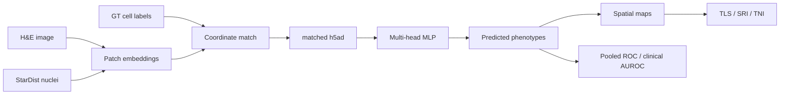

# Hist2Pheno

[](LICENSE)
[](environment.yml)
[](https://pytorch.org/)

**Predict cell phenotypes from H&E histology**, then map those predictions in space.

Hist2Pheno takes per-nucleus H&E patch embeddings (UNI, UNI2-h, H-optimus-1, HIPT, Virchow2), trains a multi-head MLP to multi-tier cell-type labels, validates on independent StarDist nuclei, and supports histology-derived niche indices (TLS / SRI / TNI on CODEX; FRI / ARI / APNB on Xenium). The published pan-cancer track uses **UNI**. The encoder comparison uses one **A2** recipe for UNI, Virchow2, and UNI2: adjacent loss, L2→L1 NLL weight 2, spatial k=8 mean, no gate. UNI2 A2 pooled OOF L2 macro AUROC is **0.8894** (fold 1). The UNI2 ablation peak is A3 at 0.8897 and is not the comparison weight.

The **s1167 Pancreas (PDAC) and GIST TMA tracks** are complete end-to-end: match → UNI → h5ad → cross-dataset CV → StarDist inference → pooled ROC / clinical AUROC → TLS / SRI / TNI.

**Xenium BRCA** (10x FFPE breast preview, two neighboring replicates) and **CODEX GBM** (WangLab Visium HD IDH-mutant glioma, Initial / Recurrent) are on the same three-head train / Pred track. They do not yet have clinical niche-index notebooks.

**Xenium CRC** (Oliveira et al., *Nat Genet* 2025: Visium HD + Xenium In Situ on the same FFPE CRC blocks) transfers RCTD `DeconvolutionLabel1` from 8 µm bins onto Xenium cells, then follows the BRCA-style match / UNI / three-head train + Pred path for **P1 / P2 / P5**.

Raw images and embeddings are **not** shipped in this repository. Each dataset folder has its own README and `demo.sh` command index.

## Highlights

- **Shared modeling stack** in [`code/Hist2Pheno_pkg/`](code/Hist2Pheno_pkg/) — matching, AnnData I/O, spatial kNN fusion, training, palettes, CV helpers, and the TLS / SRI / TNI engine
- **Shared embedder** [`code/Image_feature_extraction.py`](code/Image_feature_extraction.py) — per-cell UNI / UNI2-h / H-optimus-1 / HIPT / Virchow2 patches from H&E. Weights are gated and **not** in git; see the checkpoint READMEs below.
- **Multi-cohort pipelines** — Xenium lung / BRCA / CRC plus CODEX HCC, ESCC, PDAC, GIST, and GBM; optional **joint pan-cancer** three-head model on the shared 20/8/5 ontology ([`code/PanCancer/`](code/PanCancer/))
- **StarDist external validation** — train on GT nuclei, evaluate / infer on all segmented nuclei. The pan-cancer **section-CV** checkpoint is applied to (i) **new cancers** with HE + StarDist and no GT ([`code/External_val/`](code/External_val/): NPC, Visium BRCA / CRC / HCC, HCC Nature / TIMES, HER2ST, prostate) and (ii) **unlabeled leftovers** from the training cohorts (Lung Incomplete, CODEX HCC rest, PDAC Incomplete_Cases; no niches)
- **Internal fold-0 validation** — same checkpoint on the 182 held-out training sections ([`code/Internal_val/`](code/Internal_val/)); 4×3 GT / pred / ROC / StarDist-all panels plus composition
- **s1167 TMAs done** — PDAC (278 annotated + 195 unlabeled cores) and GIST (550 annotated) share one TMA root but keep separate StarDist trees, pooled weights, and clinical notebooks
- **BRCA / GBM / CRC ports** — leave-one-sample-out (or leave-one-dataset-out) OOF + all-sample deployment weights when there are fewer sections than folds; Pred statistic notebooks (`xenium_brca`, `codex_gbm`, `xenium_crc`)



## Supported datasets

| Dataset | Folder | Scale | Labels | `pan_organ` | Pipeline |
|---------|--------|-------|--------|-------------|----------|
| Xenium lung fibrosis ([GSE250346](https://www.ncbi.nlm.nih.gov/geo/query/acc.cgi?acc=GSE250346)) | [`code/Xenium_lung/`](code/Xenium_lung/) | 25 Complete + 20 Incomplete | five-head (L2 / L12 / L1 / CNiche / TNiche) | `xenium_lung` | train + niche |
| Xenium BRCA ([Janesick et al., *Nat Commun* 2023](https://www.nature.com/articles/s41467-023-43458-x); [GSE243275](https://www.ncbi.nlm.nih.gov/geo/query/acc.cgi?acc=GSE243275)) | [`code/Xenium_brca/`](code/Xenium_brca/) | 2 neighboring replicates (rep1 / rep2) | three-head (16 L2 / 8 L12 / 4 L1) | `xenium_brca` | train + Pred |
| Xenium CRC ([Oliveira et al., *Nat Genet* 2025](https://www.nature.com/articles/s41588-025-02193-3); [GSE280318](https://www.ncbi.nlm.nih.gov/geo/query/acc.cgi?acc=GSE280318)) | [`code/Xenium_crc/`](code/Xenium_crc/) | P1 / P2 / P5 labeled | three-head (38 L2 / 9 Flex L12 / 4 L1); transferred RCTD Label1 | `xenium_crc` | train + Pred |
| CODEX HCC (s4769; [Wu et al., bioRxiv 2025](https://doi.org/10.1101/2025.06.11.656869)) | [`code/CODEX_hcc/`](code/CODEX_hcc/) | 36–38 Visium-aligned HE regions | three-head (L2 / L12 / L1) | `codex_hcc` | train + Pred + niche |
| CODEX ESCC (NCRT cohort) | [`code/CODEX_escc/`](code/CODEX_escc/) | tumor ROIs | five-tier labels | `codex_escc` | train |
| CODEX PDAC (s1167 Pancreas TMA) | [`code/CODEX_pdac/`](code/CODEX_pdac/) | 278 annotated / 195 unlabeled cores | three-head | `codex_pdac` | **full** (train + Pred + niche) |
| CODEX GIST (s1167 GIST TMA) | [`code/CODEX_gist/`](code/CODEX_gist/) | 550 annotated cores | three-head | `codex_gist` | **full** (train + Pred + niche) |
| CODEX GBM ([Tang et al., *Cancer Cell* 2025](https://www.cell.com/cancer-cell/fulltext/S1535-6108(25)00363-0)) | [`code/CODEX_gbm/`](code/CODEX_gbm/) | Initial `P174511` + Recurrent `P179161` | three-head (16 L2 subcluster / 9 L12 SN / 5 L1 cell_type) | `codex_gbm` | train + Pred |
| Pan-cancer joint (7 public cohorts; ESCC omitted) | [`code/PanCancer/`](code/PanCancer/) | ~5.5M kept cells / 896 CV sections | three-head (20 L2 / 8 L12 / 5 L1) | `pancancer` | joint train + Pred |
| Internal validation, fold 0 (same 7 cohorts) | [`code/Internal_val/`](code/Internal_val/) | 182 held-out sections | predicted L1 / L12 / L2 vs native GT | `pancancer` | predict + notebooks |
| External validation, no GT (NPC, Visium BRCA / CRC / HCC / HCC Nature, HER2ST, prostate) | [`code/External_val/`](code/External_val/) | NPC 2; BRCA 3; CRC 1; HCC 7; HCC Nature 17; HER2ST 36; prostate 35 | predicted L1 / L12 / L2 from the UNI2 A2 `best_mlp` | `pancancer` | predict + TLS / SRI / TNI |
| Unlabeled leftovers (Lung Incomplete, HCC rest, PDAC Incomplete) | [`Lung_Incomplete`](code/External_val/Lung_Incomplete/) · [`HCC_unlabel`](code/External_val/HCC_unlabel/) · [`PDAC_unlabel`](code/External_val/PDAC_unlabel/) | 20 + 8 + 195 | predicted L1 / L12 / L2 from the UNI2 A2 `best_mlp`; no niches | `pancancer` | predict + notebooks |

Start from the dataset README, then follow that folder’s `demo.sh`. Joint 7-cohort training (remap native labels → pan-cancer L1/L12/L2, do not mix ESCC) lives in [`code/PanCancer/`](code/PanCancer/). Fold-0 maps of those same cohorts: [`code/Internal_val/`](code/Internal_val/). New-cancer and unlabeled leftover predict: [`code/External_val/`](code/External_val/).

## Pan-cancer cell-type labels

A pan-cancer Hist2Pheno (same idea as Fu et al. / Kather et al., *Nat Cancer* 2020: one H&E model across organs) needs a **shared 3-level label space**. Native hierarchies stay as they are; they are mapped onto that space rather than rewritten.

**CODEX ESCC is omitted** (in-house NCRT). The seven public-cohort ground-truth hierarchies:

| Cancer | GT hierarchy (repo-relative) | Sheet | Native L2 / L12 / L1 (train) | GT cells on HE | Native L1 |
|--------|------------------------------|-------|------------------------------|----------------|-----------|
| Lung | [`data/Xemium/weiqin/SpatialPF-NGenetics/Spatial-PF-Processed/Annotation/HE_Annotations/41588_2025_2080_MOESM5_ESM.xlsx`](data/Xemium/weiqin/SpatialPF-NGenetics/Spatial-PF-Processed/Annotation/HE_Annotations/41588_2025_2080_MOESM5_ESM.xlsx) | `Celltype` | 47 / 6 / 4 (+ CNiche 12, TNiche 12) | 637,738 (Complete) | Epithelial, Immune, Endothelial, Mesenchymal |
| BRCA | [`data/Xemium/BRCA/Annotation/GSE243275_Barcode_Cell_Type_MatricesLY.xlsx`](data/Xemium/BRCA/Annotation/GSE243275_Barcode_Cell_Type_MatricesLY.xlsx) | `celltype` | 16 / 8 / 4 | 264,518 | Epithelial, Immune, Stromal, Endothelial |
| CRC | [`data/Xemium/CRC/Annotation/CRC_Barcode_Cell_Type_Matrices.xlsx`](data/Xemium/CRC/Annotation/CRC_Barcode_Cell_Type_Matrices.xlsx) | `celltype` | 38 / 9 Flex / 4 | 494,004 (P1+P2+P5 transferred singlets) | Epithelial, Immune, Stromal, Endothelial (Neuronal folded into Stromal) |
| HCC | [`data/CODEX/HCC/Michael_data_transfer/s4769/HE/s4769_he_mapping_updated_Visium.xlsx`](data/CODEX/HCC/Michael_data_transfer/s4769/HE/s4769_he_mapping_updated_Visium.xlsx) | `Celltype` | 12 / 6 / 4 | 1,095,779 | Epithelial, Immune, Stromal, Endothelial |
| PDAC | [`data/CODEX/HCC/Michael_data_transfer/s1167/raw_metadata_updated.xlsx`](data/CODEX/HCC/Michael_data_transfer/s1167/raw_metadata_updated.xlsx) | `Celltype` (`cohort=Pancreas TMA`) | 11 / 6 / 4 | 1,504,982 | Epithelial, Immune, Stromal, Endothelial |
| GIST | same s1167 workbook | `Celltype` (`cohort=GIST TMA`) | 11 / 6 / 4 | 1,785,460 | Epithelial, Immune, Stromal, Endothelial |
| GBM | [`data/CODEX/GBM/WangLab/3_Annotation_Table/GBM_sc_seg_celltypes_hierarchy.xlsx`](data/CODEX/GBM/WangLab/3_Annotation_Table/GBM_sc_seg_celltypes_hierarchy.xlsx) | `Celltype` | 16 / 9 SN / 5 | 175,210 | Tumor, Myeloid, Lymph, Oligo, Vascular |

Per-cell GT (coordinates + labels) still lives in each dataset’s Cases / Complete_Cases CSVs; the files above are the **multi-level class lists** used at match / train time.

**What agrees.** BRCA / HCC / PDAC / GIST already share a 4-class coarse L1 (Epithelial / Immune / Stromal / Endothelial). Immune L12 is consistently T / B / Myeloid. Stromal vs Endothelial are split the same way.

**What does not.** (1) Lung uses Mesenchymal instead of Stromal, and L12 is tissue-specific (Alveolar / Airway), not T-cell / B-cell. (2) GBM L1 is Tumor / Myeloid / Lymph / Oligo / Vascular; native L12 is **spatial niche SN1–SN9**, not a lineage parent of `subcluster`. (3) GIST “Stromal cells” includes KIT+ tumor (mesenchymal), so it must not be recoded to Epithelial. (4) Fine-name synonyms are rampant (`Helper T cells` = `CD4+_T_Cells` = `CD4 T cells`). (5) CRC native L1 folds Flex Neuronal into Stromal; pan-cancer v1 puts enteric glia on `Neural`. CRC labels are transferred Visium HD RCTD, not Xenium GT.

Shared ontology (one workbook): [`PanCancerCellType.xlsx`](code/Hist2Pheno_pkg/dataset/PanCancerCellType.xlsx). Rebuild: [`build_pancancer_celltype.py`](code/Hist2Pheno_pkg/dataset/build_pancancer_celltype.py).

| Sheet | Contents |
|-------|----------|
| `celltype_initial` | HE-realistic training ontology (**5 L1 / 8 L12 / 20 L2** = 17-class 5-cancer union + 3 coarse lung extras) |
| `celltype_pancancer` | Pan-cancer training subset of `celltype_initial` (same 20 L2; Other + morphologically distant natives dropped) |
| `celltype_fine` | v0 synonym inventory (5 L1 / 11 L12 / 65 trainable L2) — too fine for H&E |
| `Lung` … `CRC` | Original multi-level rows + v0 `L1/L12/L2` + v1 `L1_v1/L12_v1/L2_v1` |
| `GBM_unique_L2` | GBM collapsed to unique `subcluster` (SN triples stay on `GBM`) |
| `summary` / `Legend` | Paths, native vs unified counts, how to add Prostate |

**v1 L1 (5):** Epithelial · Immune · Stromal · Endothelial · Neural.  
**v1 L12 (8):** Tumor · Epithelial · T_cell · B_Plasma · Myeloid · Stromal · Endothelial · Neural.  
**v1 L2 (20 = 17 core + 3 lung extras).** Core is the BRCA ∪ HCC ∪ PDAC ∪ GIST ∪ GBM union: Tumor, DCIS, Epithelial, Myoepithelial, CD4_T, CD8_T, Tregs, NK, B_cell, Plasma, DC, Macrophage, Neutrophil, Fibroblast, Stromal, Endothelial, Neural. Treg is its own head (not folded into CD4_T). Unspecified T / NK (INFg+, Lymphocyte, T cells, NK/NKT) map to `NK`. Former `Macrophage_activated` (M2 / SPP1 / IFN / MDMs) is merged into `Macrophage`. Lung labels that match a core class are merged there (airway → Epithelial, homeostatic FBs → Fibroblast, immune / endothelial synonyms). Lung-only biology is added as three coarse extras — not native-fine: `Alveolar` (AT1+AT2+prolif AT2), `Injury_epithelial` (KRT5-/KRT17++RASC+transitional AT2), `Myofibroblast` (myofibroblast + activated/inflammatory/prolif FBs). Column `l2_scope` on `celltype_initial` marks `core_5union` vs `lung_unique`. **CRC maps onto this 20-class space** (Tumor I–V → `Tumor`, Enterocyte/Goblet/Tuft → `Epithelial`, enteric glia → `Neural`, SM/vSM/CAF → `Stromal`, Flex NK → `NK`); no new v1 L2. Overlap Venns and per-cohort StarDist AUROC: [`code/Hist2Pheno_pkg/dataset/L2_overlap_7datasets.ipynb`](code/Hist2Pheno_pkg/dataset/L2_overlap_7datasets.ipynb). Paper figure panels: [`Fig2_Fig3_panels.ipynb`](code/Hist2Pheno_pkg/dataset/Fig2_Fig3_panels.ipynb).

Same rule for Prostate. Cohort class inventories remain in [`Hist2Pheno_Datasets.xlsx`](code/Hist2Pheno_pkg/dataset/Hist2Pheno_Datasets.xlsx).

## Repository layout

```text
Hist2Pheno/
├── code/
│   ├── Hist2Pheno_pkg/          # shared library
│   │   └── dataset/             # Hist2Pheno_Datasets.xlsx + PanCancerCellType.xlsx
│   ├── Image_feature_extraction.py
│   ├── StarDist_nuclei_segmente.py
│   ├── UNI/                     # UNI-l weights (not shipped)
│   ├── UNI2/                    # UNI2-h weights (not shipped)
│   ├── H-optimus-1/             # H-optimus-1 weights (not shipped)
│   ├── HIPT/
│   ├── Xenium_lung/
│   ├── Xenium_brca/             # 10x FFPE breast preview (rep1 / rep2)
│   ├── Xenium_crc/              # Oliveira et al. Visium HD + Xenium CRC
│   ├── CODEX_hcc/
│   ├── CODEX_escc/
│   ├── CODEX_pdac/              # s1167 Pancreas TMA (shared mapping + niche engine)
│   ├── CODEX_gist/              # s1167 GIST TMA (thin wrappers + notebooks)
│   ├── CODEX_gbm/               # WangLab microscope HE + Visium HD labels
│   ├── PanCancer/               # joint 7-cohort 3-head model (sheet celltype_pancancer)
│   ├── Internal_val/            # fold-0 hold-out of the 7 training cohorts
│   └── External_val/            # new cancers (no GT; includes HCC Nature / TIMES) + unlabeled leftovers (Lung Incomplete, HCC rest, PDAC Incomplete)
├── environment.yml              # dedicated Hist2Pheno conda env
├── requirements.txt
└── LICENSE
```

Processed data are expected under a local `data/` tree (gitignored). Do not commit `.h5ad`, `.pth`, `.bin`, TIFF, or model weights. `python ignore_large_files.py` scans `code/` for files over 100 MiB and lists them in `.gitignore`.

## Installation

```bash
git clone https://github.com/LingyuLi-math/Hist2Pheno.git
cd Hist2Pheno
```

Hist2Pheno was developed in the existing **SeededNTM** conda environment ([LingyuLi-math/SeededNTM](https://github.com/LingyuLi-math/SeededNTM)). This repo now ships a dedicated env of the same stack: Python **3.11**, conda-forge HDF5 / pyarrow / pyproj, then the scientific Python packages in [`requirements.txt`](requirements.txt). Keep **NumPy 1.x** (NumPy 2 breaks some pandas / scanpy combinations used here).

### Option A — create `Hist2Pheno` (recommended for GitHub)

```bash
conda env create -f environment.yml
conda activate Hist2Pheno

# CUDA PyTorch matching your driver (tested: torch 2.9 + CUDA 13.0)
# https://pytorch.org/get-started/locally/
pip install torch torchvision --index-url https://download.pytorch.org/whl/cu128

python -c "import torch; print(torch.__version__, torch.cuda.is_available())"
python -m ipykernel install --user --name Hist2Pheno --display-name "Python (Hist2Pheno)"
```

`cu128` is an example index. Change it if your driver needs another CUDA wheel.

### Option B — clone the existing `SeededNTM` env (this machine)

If `SeededNTM` is already installed and working:

```bash
conda create --name Hist2Pheno --clone SeededNTM
conda activate Hist2Pheno
```

Then run Hist2Pheno with `conda activate Hist2Pheno` (or `conda run -n Hist2Pheno ...`) instead of `SeededNTM`.

Foundation-model **weights are not bundled** (GitHub’s 100 MiB limit; UNI2-h is ~2.6 GiB, H-optimus-1 ~4.3 GiB). Accept each model’s license on Hugging Face, `huggingface_hub.login()` with a token, then download into the paths below. Dataset `demo.sh` scripts use **UNI** unless you change `--method`.

| `--method` | Hugging Face | Put `pytorch_model.bin` here | Embedding | Notes |
|------------|--------------|------------------------------|-----------|-------|
| `UNI` | [MahmoodLab/uni](https://huggingface.co/MahmoodLab/uni) | [`code/UNI/assets/ckpts/vit_large_patch16_224.dinov2.uni_mass100k/`](code/UNI/assets/ckpts/vit_large_patch16_224.dinov2.uni_mass100k/README.md) | 1024-d | default pan-cancer embedder (~1.2 GiB); ViT-L/16 class token |
| `UNI2` | [MahmoodLab/UNI2-h](https://huggingface.co/MahmoodLab/UNI2-h) | [`code/UNI2/assets/ckpts/uni2-h/`](code/UNI2/assets/ckpts/uni2-h/README.md) | 1536-d | gated; ViT-H/14 class token |
| `H-optimus-1` | [bioptimus/H-optimus-1](https://huggingface.co/bioptimus/H-optimus-1) | [`code/H-optimus-1/assets/ckpts/`](code/H-optimus-1/assets/ckpts/README.md) | 1536-d | gated; **CC BY-NC-ND 4.0**; ViT-G/14 class token; `--patch_size 224` |
| `HIPT` | [mahmoodlab/HIPT](https://github.com/mahmoodlab/HIPT) | `code/HIPT/HIPT_4K/Checkpoints/` | 384-d | ViT-256 CLS (`vit256_small_dino.pth`) |
| `Virchow2` | [paige-ai/Virchow2](https://huggingface.co/paige-ai/Virchow2) | Hugging Face hub (timm) | 1280-d | gated; per-token after dropping 5 register tokens |

Scripts add `code/Hist2Pheno_pkg` to `sys.path`. For ad-hoc imports:

```bash
export PYTHONPATH="${PWD}/code/Hist2Pheno_pkg:${PYTHONPATH}"
```

### GPU selection

UNI extraction and MLP training use the **first visible** device (`cuda:0` after masking). Pin a physical GPU **before** importing PyTorch:

```bash
export CUDA_VISIBLE_DEVICES=1          # physical GPU 1 → logical cuda:0
```

Training CLIs also accept `--cuda-device 1` when `CUDA_VISIBLE_DEVICES` is unset.  
Matching / h5ad transfer (`transer_embedding_label_h5ad.py`) is CPU.  
Notebooks: set `NCRT_CUDA_DEVICE` **before** `import torch`, then restart the kernel. See [`code/CODEX_gist/README.md`](code/CODEX_gist/README.md) for a worked GPU-pinning example.

## Typical workflow

Every CODEX / Xenium track follows **match → embed → h5ad → train**, then dataset notebooks for CV maps, prediction statistics, and (where available) niche indices. The walkthrough below is PDAC. GIST is the same sequence with `CODEX_gist` and `result_all_spatial_gist`. BRCA / GBM / CRC stop after Pred statistic (see below).

```bash
conda activate Hist2Pheno   # or SeededNTM, if you have not cloned the env yet
cd /path/to/Hist2Pheno

# 1. Match GT cells to HE pixels (and StarDist, if annotated)
python -u code/CODEX_pdac/match_codex_cells_with_pixel.py

# 2. Per-nucleus UNI embeddings (GPU)
bash code/CODEX_pdac/demo_UNI_feature_extraction_batch.sh gt
bash code/CODEX_pdac/demo_UNI_feature_extraction_batch.sh stardist

# 3. Write matched / all-nuclei AnnData
python -u code/CODEX_pdac/transer_embedding_label_h5ad.py --steps he_h5ad
python -u code/CODEX_pdac/transer_embedding_label_h5ad.py --steps stardist_h5ad stardist_all_h5ad

# 4. Cross-dataset train + StarDist inference (GPU)
python -u code/CODEX_pdac/PDAC_train_validate_cv_UNIlabel.py \
  --mode cross-dataset \
  --use-spatial-context --spatial-k 8 --spatial-mode mean \
  --pooled-save-result result_all_spatial_pdac

# 5. Interactive CV / spatial maps (default: load CLI weights, do not retrain)
#    open PDAC_train_validate_cv_UNIlabel_all.ipynb

# 6. Histology-derived niche index (TLS / SRI / TNI on matched StarDist)
#    open PDAC_histology_derived_niche_index.ipynb

# 7. Pooled ROC + per-core macro AUROC vs clinical groups
#    open Pred_statistic_visual_pdac_all.ipynb
```

GIST analog: `GIST_train_validate_cv_UNIlabel.py --pooled-save-result result_all_spatial_gist`, then [`GIST_histology_derived_niche_index.ipynb`](code/CODEX_gist/GIST_histology_derived_niche_index.ipynb) and [`Pred_statistic_visual_gist_all.ipynb`](code/CODEX_gist/Pred_statistic_visual_gist_all.ipynb).

CLI default ablation tag is **`D_emph_L2`** even with `--use-spatial-context`. BRCA / GBM / CRC demos use **`D_emph_L2_spatial_brca`** / **`D_emph_L2_spatial_gbm`** / **`D_emph_L2_spatial_crc`**. The joint pan-cancer run uses **`D_emph_L2_spatial_pancancer`** (cell-stratified: **`D_emph_L2_spatial_pancancer_cellstrat`**). Notebooks must use the same tag (`SKIP_POOLED_TRAIN=True` loads `best_mlp_gpu.pt` without retraining or refitting).  
When pooled group CV has **fewer sections than `--cv-k`** (or each fold trains on a single section), OOF stays leave-one-section-out and **`best_mlp_gpu.pt` is refit on all samples** for StarDist / new sections.  
h5ad builders skip a sample when the cache is valid; pass `--force-rebuild` to overwrite. Pooled StarDist validation needs `--steps stardist_h5ad`, not only `stardist_all_h5ad`.

Full command lists: [`code/Xenium_lung/demo.sh`](code/Xenium_lung/demo.sh), [`code/Xenium_brca/demo.sh`](code/Xenium_brca/demo.sh), [`code/Xenium_crc/demo.sh`](code/Xenium_crc/demo.sh), [`code/CODEX_hcc/demo.sh`](code/CODEX_hcc/demo.sh), [`code/CODEX_pdac/demo.sh`](code/CODEX_pdac/demo.sh), [`code/CODEX_gist/demo.sh`](code/CODEX_gist/demo.sh), [`code/CODEX_gbm/demo.sh`](code/CODEX_gbm/demo.sh), [`code/CODEX_escc/demo.sh`](code/CODEX_escc/demo.sh), [`code/PanCancer/demo.sh`](code/PanCancer/demo.sh), [`code/Internal_val/demo.sh`](code/Internal_val/demo.sh), [`code/External_val/NPC/demo.sh`](code/External_val/NPC/demo.sh), [`code/External_val/BRCA/demo.sh`](code/External_val/BRCA/demo.sh), [`code/External_val/CRC/demo.sh`](code/External_val/CRC/demo.sh), [`code/External_val/HCC/demo.sh`](code/External_val/HCC/demo.sh), [`code/External_val/HCC_nature/demo.sh`](code/External_val/HCC_nature/demo.sh), [`code/External_val/BRCA_ST/demo.sh`](code/External_val/BRCA_ST/demo.sh), [`code/External_val/Prostate/demo.sh`](code/External_val/Prostate/demo.sh), [`code/External_val/Lung_Incomplete/demo.sh`](code/External_val/Lung_Incomplete/demo.sh), [`code/External_val/HCC_unlabel/demo.sh`](code/External_val/HCC_unlabel/demo.sh), [`code/External_val/PDAC_unlabel/demo.sh`](code/External_val/PDAC_unlabel/demo.sh). Xenium CRC: [`demo.sh`](code/Xenium_crc/demo.sh) + [`code/Xenium_crc/README.md`](code/Xenium_crc/README.md). Pan-cancer joint train: [`code/PanCancer/README.md`](code/PanCancer/README.md). Fold-0 maps: [`code/Internal_val/README.md`](code/Internal_val/README.md). New-cancer predict: [`code/External_val/README.md`](code/External_val/README.md).

### Prediction heads

| Head | Role | Typical column |
|------|------|----------------|
| L2 | Fine cell type | `final_CT` |
| L12 | Intermediate / sublineage | `final_sublineage` |
| L1 | Coarse lineage | `final_lineage` |
| L3 / L4 | CNiche / TNiche (Xenium) or ESCC coarse / lineage-bucket | dataset-specific |

Xenium lung uses all five heads. HCC / PDAC / GIST / BRCA / GBM / CRC use L2 + L12 + L1. On GBM those heads are **subcluster / spatial_niche (SN1–SN9) / cell_type**, not a copy of L1. On CRC they are **Flex Level2 / Flex 9-class Level1 / 4-class coarse L1** (transferred RCTD Label1). Palettes live in [`plotting_palettes.py`](code/Hist2Pheno_pkg/plotting_palettes.py); see the [package README](code/Hist2Pheno_pkg/README.md). Cohort class lists: [`Hist2Pheno_Datasets.xlsx`](code/Hist2Pheno_pkg/dataset/Hist2Pheno_Datasets.xlsx). Shared pan-cancer ontology (seven public cohorts in the workbook; ESCC excluded): [`PanCancerCellType.xlsx`](code/Hist2Pheno_pkg/dataset/PanCancerCellType.xlsx) sheet `celltype_initial` (inventory) and sheet `celltype_pancancer` (joint-training subset; fine inventory is `celltype_fine`).

## CODEX PDAC and GIST (s1167 TMA)

Both cohorts live under the same TMA root (`data/CODEX/HCC/Michael_data_transfer/s1167/`) and share [`s1167_img_cell_mapping.py`](code/CODEX_pdac/s1167_img_cell_mapping.py). They are **separate Hist2Pheno tracks**: do not mix StarDist folders, pooled result directories, or niche-index kernels.

| | PDAC | GIST |
|--|------|------|
| Folder | [`code/CODEX_pdac/`](code/CODEX_pdac/) | [`code/CODEX_gist/`](code/CODEX_gist/) |
| Cores | 473 (278 annotated + 195 unlabeled) | 550 (all annotated) |
| Coverslips | `c001`, `c003`, `c005`, `c007` | `c009`, `c011`, `c013` |
| StarDist | `StarDist_Segment_pdac/` | `StarDist_Segment_gist/` |
| Pooled outputs | `s1167/result_all_spatial_pdac/` | `s1167/result_all_spatial_gist/` |
| Train / infer | Train 278; infer unlabeled → `stardist_Incomplete_Cases/` | Train + infer all 550; no Incomplete_Cases |
| Pred notebook | `Pred_statistic_visual_pdac_all.ipynb` | `Pred_statistic_visual_gist_all.ipynb` |
| Niche notebook | `PDAC_histology_derived_niche_index.ipynb` | `GIST_histology_derived_niche_index.ipynb` |
| Clinical groups | coverslip, `SAMPLE_LABEL` | coverslip plus recoded `site` / `size` / mitotic / mutation / risk / primary / `tma_block` |
| Niche wrapper | `pdac_histology_derived_niche_index.py` | `gist_histology_derived_niche_index.py` |

Shared niche engine: [`s1167_histology_derived_niche_index.py`](code/CODEX_pdac/s1167_histology_derived_niche_index.py) (`configure("codex_pdac")` or `configure("codex_gist")`) on top of [`histology_niche_index.py`](code/Hist2Pheno_pkg/histology_niche_index.py). **Do not import both wrappers in one kernel** — `configure()` is global.

GIST Pred and clinical recoding (`recode_gist_tma_clinical`) live in **[`code/CODEX_pdac/s1167_plot.py`](code/CODEX_pdac/s1167_plot.py)**. Do not switch those notebooks to the GIST-folder `s1167_plot.py`.

Neither TMA has immunotherapy **Response**. TNI myeloid = Macrophages (GIST also counts Monocytes); endothelium includes lymphatic endothelial cells on GIST. Niche §6 defaults to `QUICK_VALIDATE=True` (six cores); set `False` for the full cohort.

Outputs under `s1167/`:

| | PDAC | GIST |
|--|------|------|
| Weights | `result_all_spatial_pdac/cross_dataset_cv/D_emph_L2/best_mlp_gpu.pt` | `result_all_spatial_gist/cross_dataset_cv/D_emph_L2/best_mlp_gpu.pt` |
| Niche | `result_all_spatial_pdac/niche_index_pdac/` | `result_all_spatial_gist/niche_index_gist/` |
| Clinical viz | `result_all_spatial_pdac/clinical_viz_pdac/` | `result_all_spatial_gist/clinical_viz_gist/` |

## Xenium BRCA and CODEX GBM

These ports reuse the HCC-style **three-head** CLI + `_single` / `_all` notebooks + Pred statistic. Cross-dataset **OOF** is leave-one-sample-out (two samples each). Because `n_sections < cv_k`, **`best_mlp_gpu.pt` is then refit on all cells** (LORO fold kept as `best_mlp_gpu_loro.pt`) so StarDist and new sections see every class. `_all` notebooks with `SKIP_POOLED_TRAIN=True` only **load** that checkpoint. UNI / train jobs are large; pin a GPU and do not launch them accidentally. There is **no** clinical niche-index notebook yet (no Response / coverslip-style groups). CRC is the same train + Pred layout with three patients (see below).

| | Xenium BRCA | CODEX GBM |
|--|-------------|-----------|
| Folder | [`code/Xenium_brca/`](code/Xenium_brca/) | [`code/CODEX_gbm/`](code/CODEX_gbm/) |
| Samples | `rep1`, `rep2` (neighboring FFPE slices) | `P174511_Initial`, `P179161_Recurrent` |
| Labels | 16 L2 / 8 L12 / 4 L1 (`Unlabeled` + 3 red L2 dropped) | L2=`subcluster` (16), L12=`spatial_niche` SN1–SN9 (9), L1=`cell_type` (5); drop `Unknown` / `LowQ` / SN LowQ |
| Trainable nuclei | 157k + 107k on HE; StarDist-matched 147k + 98k | 37,371 Ini + 137,839 Rec after filters |
| Coordinates | Explorer `*_he_imagealignment.csv` → OME HE → working `*_he_image.tif`; UNI `--scale` ≈ 0.84 | `loc.csv` already on microscope HE pixels (no affine); UNI `scale_image=False` |
| Pooled outputs | `data/Xemium/BRCA/Results/result_all_spatial/` | `data/CODEX/GBM/Results/result_all_spatial/` |
| Ablation tag | `D_emph_L2_spatial_brca` | `D_emph_L2_spatial_gbm` |
| Pred notebook | `Pred_statistic_visual_brca_all.ipynb` (rep1 vs rep2) | `Pred_statistic_visual_gbm_all.ipynb` (Initial vs Recurrent) |

The GBM folder is named CODEX for pipeline layout; the images are **microscope HE**, not CODEX. BRCA’s on-disk root is `data/Xemium/BRCA/` (historical spelling).

## Xenium CRC (Visium HD companion)

Oliveira et al. (*Nat Genet* 2025) profiled FFPE CRC with **Visium HD** (2 µm capture, analyzed at 8 µm) and validated a subset with **Xenium In Situ**. Hist2Pheno keeps both: RCTD deconvolution on Visium HD bins, then nearest-bin transfer onto Xenium cells (the alignment CSVs have centroids, not cell types).

**P1 / P2 / P5** are on the BRCA-style **three-head** path (match → UNI → pooled CV → StarDist → Pred). Labels remain **transferred RCTD singlet**, not native Xenium GT. There is **no** clinical niche-index notebook (no Response / coverslip-style groups). Command index: [`code/Xenium_crc/demo.sh`](code/Xenium_crc/demo.sh).

| | |
|--|--|
| Folder | [`code/Xenium_crc/`](code/Xenium_crc/) |
| Samples | `P1CRC`, `P2CRC`, `P5CRC` (Excel / folders `P1_CRC`, `P2_CRC`, `P5_CRC`) |
| Cell type | `DeconvolutionLabel1` (RCTD first type = Flex **Level2**, 38 classes). `DeconvolutionLabel2` is ignored. Train L12 = Flex 9-class Level1; L1 = 4 coarse parents (Neuronal → Stromal) |
| Transferred cells on HE | 154,760 (P1) + 209,779 (P2) + 129,465 (P5) = **494,004**; StarDist-matched 96,858 + 166,503 + 94,194 |
| Coordinates | paper `x_centroid_visium_scale` / `y_centroid_visium_scale` on add-on HE OME (~0.274 µm/px); UNI `--scale` ≈ 0.548 |
| Pooled outputs | `data/Xemium/CRC/Results/result_all_spatial/` |
| Ablation tag | `D_emph_L2_spatial_crc` |
| Train / infer | [`CRC_train_validate_cv_UNIlabel.py`](code/Xenium_crc/CRC_train_validate_cv_UNIlabel.py) `--mode cross-dataset` (3-sample leave-one-dataset-out; `best_mlp_gpu.pt` refit on all cells) |
| Notebooks | [`CRC_train_validate_cv_UNIlabel_single.ipynb`](code/Xenium_crc/CRC_train_validate_cv_UNIlabel_single.ipynb) (one sample); [`CRC_train_validate_cv_UNIlabel_all.ipynb`](code/Xenium_crc/CRC_train_validate_cv_UNIlabel_all.ipynb) (`SKIP_POOLED_TRAIN=True`); [`Pred_statistic_visual_crc_all.ipynb`](code/Xenium_crc/Pred_statistic_visual_crc_all.ipynb) (P1 vs P2 vs P5) |
| Visium HD bins | `P{1,2,5}CRC_Metadata.parquet` (on-tissue ~508k / 546k / 542k; RCTD-assigned 311k / 431k / 392k) |
| Xenium cells | 1.12M / 1.11M / 1.03M; ~24–29% fall in the Visium capture bbox and map at median **~3.2 µm** (one 8 µm bin) |
| Visium HD data | `data/VisiumHD/CRC/P{1,2,5}_CRC/` ([10x CRC dataset](https://www.10xgenomics.com/products/visium-hd-spatial-gene-expression/dataset-human-crc); GEO [GSE280318](https://www.ncbi.nlm.nih.gov/geo/query/acc.cgi?acc=GSE280318)) |
| Xenium alignment | `data/Xemium/CRC/Xenium_Visium_Alignment/Xenium_P{1,2,5}_cell_info.csv` |
| Hierarchy xlsx | [`data/Xemium/CRC/Annotation/CRC_Barcode_Cell_Type_Matrices.xlsx`](data/Xemium/CRC/Annotation/CRC_Barcode_Cell_Type_Matrices.xlsx) sheets `celltype`, `P1_CRC`, `P2_CRC`, `P5_CRC` |
| Paper metadata | [`code/Xenium_crc/HumanColonCancer_VisiumHD/`](code/Xenium_crc/HumanColonCancer_VisiumHD/) (clone of [10XGenomics/HumanColonCancer_VisiumHD](https://github.com/10XGenomics/HumanColonCancer_VisiumHD); Hist2Pheno uses `SingleCell_MetaData_2025.csv`) |

Do not mix Visium HD 8 µm bin coordinates with Xenium HE pixels without the paper alignment tables.

## Pan-cancer joint model (7 public cohorts)

[`code/PanCancer/`](code/PanCancer/) trains **one** three-head MLP on sheet `celltype_pancancer` (20 L2 / 8 L12 / 5 L1; ESCC omitted). Native labels are remapped on read; UNI embeddings stay in each cohort `*_matched_features.h5ad`. Command index: [`demo.sh`](code/PanCancer/demo.sh). Details: [`code/PanCancer/README.md`](code/PanCancer/README.md).

Default CV is **cross-dataset section** 5-fold (`--group-splitter cross_dataset_section`): each HE section is wholly train or val; every fold mixes cohorts. Ablation tag **`D_emph_L2_spatial_pancancer`**. Pool ≈ 5.5M cells × 1024-d (~22 GB); smoke with `--datasets BRCA GBM --max-cells-per-section 5000`. Fold 0 of that split (182 sections) is plotted in [`code/Internal_val/`](code/Internal_val/).

Optional **cell-stratified** CV (`--group-splitter cell_stratified`) mixes cells across sections with StratifiedKFold on L1|L12|L2 so every abundant type (including BRCA-only DCIS and Lung-only Injury_epithelial) appears in every fold. Spatial kNN is split-masked. Hierarchical L1→L12→L2 sampling is on by default. Same-section cells in train and val make OOF optimistic vs a new slide — use section CV for that.

| | Section CV (default) | Cell-stratified |
|--|----------------------|-----------------|
| folder | `data/PanCancer/result_all_spatial/` | `data/PanCancer/result_cell_stratified_spatial/` |
| tag | `D_emph_L2_spatial_pancancer` | `D_emph_L2_spatial_pancancer_cellstrat` |
| train log | `data/PanCancer/train.log` (`1_demo_train.sh section train`) | `data/PanCancer/train_cell_stratified.log` (`1_demo_train.sh celltype train`) |
| predict | `data/PanCancer/pred_all_spatial/` + `predict.log` (`3_demo_pred.sh section predict`; **section-CV** checkpoint) | `3_demo_pred.sh celltype predict` writes `pred_cell_stratified_spatial/` from that checkpoint |

Step 4 (`PanCancer_predict_visualize.py`) does **not** write into `result_cell_stratified_spatial/`. Notebook [`4_Pred_statistic_visual_pancancer_all.ipynb`](code/PanCancer/4_Pred_statistic_visual_pancancer_all.ipynb) pools the ROC from the UNI2 A2 deployment, `pred_uni2_A2_adjacent_spatial_k8mean_paired_v2_seed42_deployment/` (all 896 sections, including sections the weight saw in training). Its last section scores the three A2 `best_mlp` weights on those same sections and writes `data/PanCancer/embedder_A2_compare/a2_deployment_sections.csv`, `a2_deployment_overall.csv`, `a2_deployment_by_cancer.csv`, and `a2_deployment_l2_by_cancer.pdf`. Pooled OOF, including UNI vs Virchow2 vs UNI2 at A2, stays in [`2_Pred_statistic_visual_pancancer_uni2_ablation.ipynb`](code/PanCancer/2_Pred_statistic_visual_pancancer_uni2_ablation.ipynb) (`a2_pooled_oof.csv`, `a2_fold_oof.csv`, `a2_fold_oof_l2.pdf` in the same directory). The two wrappers are [`1_demo_train.sh`](code/PanCancer/1_demo_train.sh) (index and train) and [`3_demo_pred.sh`](code/PanCancer/3_demo_pred.sh) (score sections). The walkthrough below is **UNI2 A2** (adjacent loss, spatial k=8 uniform mean, no gate). UNI and Virchow2 A2 deployment are [`pred_uni_A2.sh`](code/PanCancer/pred_uni_A2.sh) and [`pred_virchow2_A2.sh`](code/PanCancer/pred_virchow2_A2.sh). [`demo.sh`](code/PanCancer/demo.sh) remains the published UNI dispatcher (`1_demo_train.sh section train`, then `3_demo_pred.sh section predict`). The published UNI `pred_all_spatial/` tree is the internal-validation fold-0 run below, not notebook 4.

Per-cohort match → coordinate CSV → `*_matched_features.h5ad` is assumed done. Those h5ads hold labels and HE coordinates. They do not hold UNI2 tokens. Steps 0 and 1 are independent of each other; step 3 needs both. The runnable chain stops at step 3: its OOF is the held-out score. Step 4 is commented out. It only rescores every training section with one weight, including sections that weight already saw. `stardist` extraction is not in this chain. Default conda env inside the extractor and the two PanCancer scripts is `SeededNTM`. `CUDA_DEVICE` is the card index; leave `CUDA_VISIBLE_DEVICES` unset. The extractor pins the checkout to `/home/lingyu/ssd2/Python/Hist2Pheno`.

```bash
cd /home/lingyu/ssd2/Python/Hist2Pheno

# 0. UNI2-h tokens for matched GT cells (GPU, one cohort at a time).
#    patch_size=14, one class token, stored as embeddings.h5ad under
#    project_all_UNI2/ImgEmbeddings_all/sc_pth_14_14.
#    Lung / BRCA / CRC are rescaled to 0.5 µm/px (0.425 / 0.84 / 0.548).
#    HCC, PDAC, GIST, and GBM stay on native pixels.
#    A section whose embeddings.h5ad is already complete is skipped.
#    Finish all seven before step 3. Do not run two extracts into the same tree,
#    and do not start step 3 while an extract is still writing.
#    This does not build the matched h5ad. Mode stardist is a separate all-nuclei store
#    and is not read by steps 1, 3, or 4.
bash code/Hist2Pheno_pkg/run_uni2_patch14.sh lung gt 0
bash code/Hist2Pheno_pkg/run_uni2_patch14.sh brca gt 0
bash code/Hist2Pheno_pkg/run_uni2_patch14.sh crc gt 0
bash code/Hist2Pheno_pkg/run_uni2_patch14.sh hcc gt 0
bash code/Hist2Pheno_pkg/run_uni2_patch14.sh pdac gt 0
bash code/Hist2Pheno_pkg/run_uni2_patch14.sh gist gt 0
bash code/Hist2Pheno_pkg/run_uni2_patch14.sh gbm gt 0

# 1. Section index (CPU, no training).
#    Scans the seven cohort matched h5ads, remaps labels to celltype_pancancer,
#    and writes data/PanCancer/section_index.csv. Embeddings stay in the cohort files.
#    An existing data/PanCancer/fold_plan.csv is kept, so fold ids do not shuffle.
#    Re-run after adding or relabeling a cohort h5ad. Skip if section_index.csv is current;
#    training can discover h5ads itself when that file is absent.
bash code/PanCancer/1_demo_train.sh index

# 2. Optional smoke (GPU, about two epochs on BRCA + GBM, 5k cells/section).
#    Same A2 recipe as the full run. Writes result_uni2_smoke_A2_paired_v2_seed42/.
#    Do not start a second uni2 job until this one finishes: the first prepare builds
#    data/PanCancer/uni2_aligned/, and a parallel prepare will race that cache.
# CUDA_DEVICE=0 bash code/PanCancer/1_demo_train.sh uni2 smoke

# 3. Train UNI2 A2 (GPU, long).
#    Reads section_index.csv from step 1 and aligns each section's step-0
#    embeddings.h5ad onto that matched h5ad by HE coordinates (1536-d).
#    Cross-section 5-fold, inner val 0.2, class-weight balanced, seeds 42.
#    Steps: prepare, train, he_validate. Spatial context is k=8 mean.
#    Checkpoint: data/PanCancer/result_uni2_A2_adjacent_spatial_k8mean_paired_v2_seed42/cross_dataset_cv/A2_adjacent_spatial_k8mean/best_mlp_gpu.pt
#    That best_mlp is fold 1. Log: code/log/pancancer_section_uni2_A2_adjacent_spatial_k8mean_paired_v2_seed42.log
#    The fold plan used by this weight is the fold_plan.csv inside that result directory, not the index preview.
CUDA_DEVICE=0 bash code/PanCancer/1_demo_train.sh uni2 A2

# 4. Optional, left commented. Deployment predict (GPU). One best_mlp on every training section, including sections it saw.
#    Loads the step-3 checkpoint and the same step-0 gt tokens. AUROC is matched GT cells.
#    The ROC directory is named stardist_roc; that name is historical and does not mean
#    StarDist tokens are read. Missing StarDist tokens only skip the all-nuclei map
#    (n_stardist_all = 0). This command also passes --skip-figures, so that map is unused.
#    This is not OOF. For the held-out fold score, set PREDICTION_MODE=oof (each section uses the fold that left it out).
#    Skips a section that already has a run stamp.
#    Output: data/PanCancer/pred_uni2_A2_adjacent_spatial_k8mean_paired_v2_seed42_deployment/
#    Log: code/log/pancancer_section_uni2_A2_predict_paired_v2_seed42_deployment.log
#    If CUDA_DEVICE is unset, this A2 command uses card 2. A set CUDA_DEVICE overrides that.
# CUDA_DEVICE=0 bash code/PanCancer/3_demo_pred.sh uni2 A2
```

### UNI2 results (paired_v2, 2026-10-28)

UNI2-h uses one class token at `patch_size=14` (1536-d, about 7 µm). Tokens are `project_all_UNI2/ImgEmbeddings_all/sc_pth_14_14` on the same pixels as the UNI crops: Xenium lung / BRCA / CRC are rescaled to 0.5 µm/px (`0.425` / `0.84` / `0.548`); CODEX HCC, PDAC, GIST, and GBM stay on native pixels (`scale_image=False`). Extractor: [`run_uni2_patch14.sh`](code/Hist2Pheno_pkg/run_uni2_patch14.sh).

The finished retrain is `paired_v2_seed42` (named-layer init, split-seed 42, L2→L1 NLL weight 2) on 5,627,071 cells / 896 sections. Image tokens are `embeddings.h5ad` inside the `sc_pth_14_14` directory (an older `embeddings.h5` is still readable). The held-out number is the pooled OOF L2 macro AUROC ([`2_Pred_statistic_visual_pancancer_uni2_ablation.ipynb`](code/PanCancer/2_Pred_statistic_visual_pancancer_uni2_ablation.ipynb)). A morning run on 2026-10-26 (A3 0.8907) used a different init and weight; those checkpoints were removed.

| Architecture | Spatial context | best_mlp fold | Pooled OOF L2 |
|--------------|-----------------|---------------|---------------|
| A0 legacy, L2→L1 weight 2 | off | 0 | 0.8580 |
| A1 adjacent loss | off | 0 | 0.8601 |
| A2 A1 + k=8 mean | on | 1 | **0.8894** |
| A3 A2 + learned gate | on | 0 | 0.8897 |

The comparison weight, and the UNI2 weight to run on external slides, is A2 fold 1 (no gate), so it matches the UNI and Virchow2 A2 recipe:

`data/PanCancer/result_uni2_A2_adjacent_spatial_k8mean_paired_v2_seed42/cross_dataset_cv/A2_adjacent_spatial_k8mean/best_mlp_gpu.pt`

UNI A2 is `data/PanCancer/result_uni_A2/cross_dataset_cv/A2_adjacent_spatial_k8mean/best_mlp_gpu.pt`. Virchow2 A2 is `data/PanCancer/result_virchow2_A2/cross_dataset_cv/A2_adjacent_spatial_k8mean/best_mlp_gpu.pt`.

`3_demo_pred.sh uni2 A2` scores every section with that one `best_mlp` (`PREDICTION_MODE=deployment`) and writes `data/PanCancer/pred_uni2_A2_adjacent_spatial_k8mean_paired_v2_seed42_deployment/`. The same scope for the other two encoders is `pred_uni_A2_deployment/` and `pred_virchow2_A2_deployment/`. The number in notebook 4 is the mean of per-section matched-cell macro AUROC on all 896 sections, not a pooled ROC and not OOF. `n_stardist_all = 0` means the all-nuclei map was skipped because that encoder's StarDist `embeddings.h5ad` was not a finished store; the L1 / L12 / L2 columns still come from matched cells. An earlier UNI2-only deployment of A0–A3, before this encoder comparison, had mean section L2 0.673 / 0.675 / 0.700 / 0.715. Notebook 4 does not regenerate that four-way table.

Each training cohort has a UNI2 notebook and a Virchow2 notebook. Both load the A2 `best_mlp_gpu.pt` above and score that cohort with `--deployment`. UNI2 uses fold 1 of `result_uni2_A2_adjacent_spatial_k8mean_paired_v2_seed42/fold_plan.csv` and writes `pred_uni2_A2_adjacent_spatial_k8mean_paired_v2_seed42_deployment/`. Virchow2 uses fold 0 of `result_virchow2_A2/fold_plan.csv` and writes `pred_virchow2_A2_deployment/`. The score cell marks the held-out sections from that fold plan. All-nuclei StarDist maps need `ImgEmbeddings_all_stardist/sc_pth_14_14/embeddings.h5ad` (`SAVE_PATCH_IMAGES=0 bash code/Hist2Pheno_pkg/run_uni2_patch14.sh` or `run_virchow2_patch14.sh` with `<lung|brca|crc|hcc|pdac|gist|gbm> stardist <gpu>`).

| Cohort | UNI2 | Virchow2 |
|--------|------|----------|
| Xenium lung | [`Lung_pred_uni2_pretrained.ipynb`](code/Xenium_lung/Lung_pred_uni2_pretrained.ipynb) | [`Lung_pred_virchow2_pretrained.ipynb`](code/Xenium_lung/Lung_pred_virchow2_pretrained.ipynb) |
| Xenium BRCA | [`BRCA_pred_uni2_pretrained.ipynb`](code/Xenium_brca/BRCA_pred_uni2_pretrained.ipynb) | [`BRCA_pred_virchow2_pretrained.ipynb`](code/Xenium_brca/BRCA_pred_virchow2_pretrained.ipynb) |
| Xenium CRC | [`CRC_pred_uni2_pretrained.ipynb`](code/Xenium_crc/CRC_pred_uni2_pretrained.ipynb) | [`CRC_pred_virchow2_pretrained.ipynb`](code/Xenium_crc/CRC_pred_virchow2_pretrained.ipynb) |
| CODEX HCC | [`HCC_pred_uni2_pretrained.ipynb`](code/CODEX_hcc/HCC_pred_uni2_pretrained.ipynb) | [`HCC_pred_virchow2_pretrained.ipynb`](code/CODEX_hcc/HCC_pred_virchow2_pretrained.ipynb) |
| CODEX PDAC | [`PDAC_pred_uni2_pretrained.ipynb`](code/CODEX_pdac/PDAC_pred_uni2_pretrained.ipynb) | [`PDAC_pred_virchow2_pretrained.ipynb`](code/CODEX_pdac/PDAC_pred_virchow2_pretrained.ipynb) |
| CODEX GIST | [`GIST_pred_uni2_pretrained.ipynb`](code/CODEX_gist/GIST_pred_uni2_pretrained.ipynb) | [`GIST_pred_virchow2_pretrained.ipynb`](code/CODEX_gist/GIST_pred_virchow2_pretrained.ipynb) |
| CODEX GBM | [`GBM_pred_uni2_pretrained.ipynb`](code/CODEX_gbm/GBM_pred_uni2_pretrained.ipynb) | [`GBM_pred_virchow2_pretrained.ipynb`](code/CODEX_gbm/GBM_pred_virchow2_pretrained.ipynb) |

## Internal validation (fold 0 of the seven training cohorts)

[`code/Internal_val/`](code/Internal_val/) applies the published **UNI** section-CV checkpoint to the **fold-0 hold-out** of Lung, BRCA, CRC, HCC, PDAC, GIST, and GBM. A section in this UNI fold 0 was not used to fit `result_all_spatial/.../best_mlp_gpu.pt`. UNI2 paired_v2 is a separate split; its held-out numbers are the pooled OOF L2 values in the section above (A2 0.8894 for the encoder comparison). Per-dataset `Data_process_visual_*.ipynb` notebooks are the other column (single-cohort models).

Predict is already on disk: `data/PanCancer/pred_all_spatial/` has all **182** fold-0 sections (`matched_pred.h5ad`, `panel_4x3.png`, StarDist ROC). `demo.sh predict` only fills gaps (`--skip-existing`). Do not overwrite `pred_all_spatial` with a cell-stratified run.

| Dataset | Fold 0 | Notebook draws |
|---------|--------|----------------|
| Lung | 5 | all 5 |
| BRCA | 1 (`rep1`) | 1 |
| CRC | 1 (`P2CRC`) | 1 |
| HCC | 8 | original 4 plus paper top 5 by L2 AUROC |
| PDAC | 56 | top 5 by L2 AUROC |
| GIST | 110 | 4 largest |
| GBM | 1 (`P174511_Initial`) | 1 |

```bash
bash code/Internal_val/demo.sh status
bash code/Internal_val/demo.sh fold0
# only if a fold-0 panel is missing
CUDA_DEVICE=1 bash code/Internal_val/demo.sh predict
ONLY=HCC bash code/Internal_val/demo.sh notebooks
```

Open `Pred_visual_{lung,brca,crc,hcc,pdac,gist,gbm}.ipynb`. Each shows the existing 4×3 panel (GT / pred / ROC / StarDist-all) plus GT vs predicted composition. `Pred_visual_fold0.ipynb` is the inventory. Details: [`code/Internal_val/README.md`](code/Internal_val/README.md).

## External validation (new slides, no ground truth)

[`code/External_val/`](code/External_val/) scores HE + StarDist nuclei that have no cell-type labels. The weight for the current figures is the UNI2 A2 `best_mlp` (fold 1, paired_v2, k=8 mean, no gate): `result_uni2_A2_adjacent_spatial_k8mean_paired_v2_seed42/cross_dataset_cv/A2_adjacent_spatial_k8mean/best_mlp_gpu.pt`. `demo_uni2.sh` and `demo_uni2_A2.sh` load that file and write `pred_uni2_A2_bestmlp_paired_v2_seed42/`. UNI A2 and Virchow2 A2 are the other comparison weights (`pred_uni_A2/`, `pred_virchow2_A2/`). `pred_pancancer_section/` is the older published UNI section-CV run (`D_emph_L2_spatial_pancancer`), not this comparison. `demo_uni2_A3.sh` is the gated A3 weight and is not the comparison model. The shared pipeline is [`Hist2Pheno_pkg/external_validation.py`](code/Hist2Pheno_pkg/external_validation.py). NPC, Visium CRC, Visium HCC, and HCC Nature are rows in `_SIMPLE_COHORTS`. Visium BRCA, HER2ST, and prostate keep their own scripts ([`brca_external.py`](code/External_val/BRCA/brca_external.py), [`brca_st_external.py`](code/External_val/BRCA_ST/brca_st_external.py), [`prostate_external.py`](code/External_val/Prostate/prostate_external.py)) because the sample id and µm/px are not one flat folder plus one HE suffix. Unlabeled leftovers from the seven training cohorts go through [`unlabeled_external.py`](code/External_val/unlabeled_external.py) and **do not** compute TLS / SRI / TNI.

`ome_um_per_px` reads OME `PhysicalSizeX` / `PhysicalSizeY` from the TIFF `ImageDescription` on every run. NPC (~0.465 µm/px), Visium BRCA (~0.548 µm/px), and Visium CRC (~0.274 µm/px, BigTIFF) are those measurements, then rescaled so a 16 px UNI crop is 8 µm. Visium HCC JPEGs have no OME block; `demo.sh` requires `MPP_UM` and defaults to **GPU 2** (`CUDA_DEVICE=2`). HCC Nature TIFFs (`data/Visium/HCC/nature_data/`) resolve µm/px per slide (OME ~0.501, Aperio `MPP`, or fallback 0.5). HER2ST JPEGs use the 200 µm spot pitch (~0.92 µm/px on patient A, ~0.69 µm/px on B–H). Prostate JPEGs use the HEST spot-spacing estimate (patient 1 ~0.57–0.69 µm/px, patient 2 ~0.34–0.35 µm/px). A 72, 96, or 300 dpi tag is not a pixel size.

| Cohort | Slides | Nuclei | µm/px | Status |
|--------|--------|--------|-------|--------|
| NPC | 2 OME TIFFs | 142,184 + 120,888 | OME ~0.465 | predicted |
| Visium BRCA | 3 (GSM OME + 2 pathology JPEGs) | ~281k + ~372k + ~391k | GSM OME ~0.548; JPEGs Visium×HE÷SR ~0.172 | predicted |
| Visium CRC | 1 OME BigTIFF (P2) | 579,587 | OME ~0.274 | predicted |
| Visium HCC | 7 JPEGs (`P1_N` … `P7_T`) | ~1.34M | `MPP_UM` | predicted |
| HCC Nature | 17 TIFFs (`L-8001_HE` … `L-8017_1_HE.ome`) | ~3.68M | OME / Aperio / fallback 0.5 | predicted |
| HER2ST | 36 JPEGs (A1–H3) | 2.42M | 200 µm spot pitch | predicted |
| Prostate | 35 JPEGs (patient 1: 7; patient 2: 28) | 7.43M | HEST spot spacing | predicted |

Unlabeled leftovers (no cell-type CSV; **no niches**). UNI2 A2 predictions are under `data/PanCancer/pred_uni2_A2_bestmlp_paired_v2_seed42/unlabel/`:

| Folder | Data | Slides | UNI2 A2 preds | Notebook |
|--------|------|--------|---------------|----------|
| [`Lung_Incomplete`](code/External_val/Lung_Incomplete/) | Xenium `Incomplete_Cases` | 20 | 20/20 in `unlabel/Lung_Incomplete/` | all 20; top 5 matched L2 AUROC first; TILD113LA / VUILD105MA1 ROI zooms |
| [`HCC_unlabel`](code/External_val/HCC_unlabel/) | CODEX HCC rest (not Visium `HCC/`) | 8 | 8/8 in `unlabel/HCC_unlabel/` | 5 largest |
| [`PDAC_unlabel`](code/External_val/PDAC_unlabel/) | CODEX PDAC Incomplete_Cases | 195 | 195/195 in `unlabel/PDAC_unlabel/` | [`Pred_visual_pdac_unlabel.ipynb`](code/External_val/PDAC_unlabel/Pred_visual_pdac_unlabel.ipynb) draws 9 cores (3 per coverslip); [`Pred_visual_pdac_unlabel_uni2_A2.ipynb`](code/External_val/PDAC_unlabel/Pred_visual_pdac_unlabel_uni2_A2.ipynb) draws the 5 largest |

Current UNI2 A2 outputs are `pred_uni2_A2_bestmlp_paired_v2_seed42/` under `data/Visium/{NPC,BRCA,CRC,HCC,Prostate}/`, `data/Visium/HCC/nature_data/`, `data/ST/BRCA/`, and `data/PanCancer/.../unlabel/{Lung_Incomplete,HCC_unlabel,PDAC_unlabel}/`. Older UNI section-CV outputs remain in `pred_pancancer_section/` and `data/PanCancer/pred_unlabel/`. Notebooks `Pred_visual_*_uni2_A2.ipynb` show L1/L12/L2 from the UNI2 A2 weight; new-cancer notebooks also draw TLS / SRI / TNI from L2 softmax (radius 55 µm). HER2ST is one notebook per patient (`Pred_visual_brca_st_A.ipynb` … `H`); Prostate is split by series (`Pred_visual_prostate_patient1_{H1,H2,V1}.ipynb`, `Pred_visual_prostate_patient2_{H1,H2,H3,V1,V2}.ipynb`). HCC Nature is **not** the seven Visium HCC JPEGs: 17 TIFFs from Jia *et al.*, *Nature* 2025 (TIMES). All 17 have a UNI2 A2 `*_stardist_pred.h5ad`. [`Pred_visual_hcc_nature_uni2_A2.ipynb`](code/External_val/HCC_nature/Pred_visual_hcc_nature_uni2_A2.ipynb) draws an H&E-only AS / IF / TC split on the L-8012 Extended Data Fig. 1a zoom; the dashed line follows that panel’s capsule (left arch, cleft, right arch), not a tumour-fraction box. Do **not** claim a TIMES score. This track is separate from Xenium BRCA training, Xenium CRC training, and CODEX HCC (s4769) training.

```bash
bash code/External_val/NPC/demo.sh all
bash code/External_val/BRCA/demo.sh all
bash code/External_val/CRC/demo.sh all
MPP_UM=0.5 bash code/External_val/HCC/demo.sh dry-run   # 0.5 is a placeholder; set the scanner µm/px
bash code/External_val/HCC_nature/demo.sh status        # 17 Nature TIFFs; all predicted
SAMPLE=A bash code/External_val/BRCA_ST/demo.sh dry-run          # one HER2ST patient; all 36 slides are ~2.4M nuclei
SAMPLE=Patient_1 bash code/External_val/Prostate/demo.sh dry-run # one patient; 35 sections are ~7.4M nuclei
bash code/External_val/Lung_Incomplete/demo.sh status
bash code/External_val/HCC_unlabel/demo.sh status
bash code/External_val/PDAC_unlabel/demo.sh status
# optional batch of Pred_visual notebooks (does not rewrite the .ipynb)
bash code/External_val/demo.sh notebooks
```

### UNI2 A2 predictions on the external slides

`demo_uni2.sh` loads the paired_v2 A2 weight (fold 1, k=8 mean, no gate) and writes `pred_uni2_A2_bestmlp_paired_v2_seed42/`. Tokens stay in `project_all_UNI2/` (`patch_size=14`). A finished slide is skipped when `embedding_manifest.json` is completed for the current extractor. Do not start two `features` jobs on the same `project_all_UNI2` tree. `Pred_visual_*_uni2_A3.ipynb` and `demo_uni2_A3.sh` are the gated A3 weight, not the comparison model.

Prediction files present under that A2 directory (2026-11-03):

| Cohort | UNI2 A2 `*_stardist_pred.h5ad` |
|--------|--------------------------------|
| NPC | 2/2 |
| Visium BRCA | 4/4 (three original slides plus `V1_Breast_Cancer_Block_A_Section_1`) |
| Visium CRC | 1/1 |
| Visium HCC | 7/7 (`MPP_UM=0.5`) |
| HCC Nature | 17/17 |
| HER2ST | 36/36 |
| Prostate | 35/35 |
| Lung Incomplete | 20/20 |
| HCC rest | 8/8 |
| PDAC Incomplete | 195/195 |

```bash
CUDA_DEVICE=0 bash code/External_val/NPC/demo_uni2.sh predict
MPP_UM=0.5 CUDA_DEVICE=0 bash code/External_val/HCC/demo_uni2.sh predict
CUDA_DEVICE=0 bash code/External_val/PDAC_unlabel/demo_uni2_A2.sh predict
```

## Data

This repo tracks **code only**. Point each pipeline at your local copy:

| Project | Local layout (example) | GT cell-type hierarchy | Notes |
|---------|------------------------|------------------------|--------|
| Xenium lung | `Spatial-PF-Processed/Data/{Complete,Incomplete}_Cases/` | `Annotation/HE_Annotations/41588_2025_2080_MOESM5_ESM.xlsx` sheet `Celltype` | [GSE250346](https://www.ncbi.nlm.nih.gov/geo/query/acc.cgi?acc=GSE250346); see [`code/Xenium_lung/README.md`](code/Xenium_lung/README.md) |
| Xenium BRCA | `data/Xemium/BRCA/` | `Annotation/GSE243275_Barcode_Cell_Type_MatricesLY.xlsx` sheet `celltype` | [Janesick et al., *Nat Commun* 2023](https://www.nature.com/articles/s41467-023-43458-x); 10x FFPE Human Breast Cancer preview + [GSE243275](https://www.ncbi.nlm.nih.gov/geo/query/acc.cgi?acc=GSE243275); see [`code/Xenium_brca/README.md`](code/Xenium_brca/README.md) |
| Xenium CRC | `data/Xemium/CRC/` (Xenium) + `data/VisiumHD/CRC/` (Visium HD) | `Annotation/CRC_Barcode_Cell_Type_Matrices.xlsx` sheet `celltype` (transferred RCTD Label1) | [Oliveira et al., *Nat Genet* 2025](https://www.nature.com/articles/s41588-025-02193-3); [10x Visium HD CRC](https://www.10xgenomics.com/products/visium-hd-spatial-gene-expression/dataset-human-crc); GEO [GSE280318](https://www.ncbi.nlm.nih.gov/geo/query/acc.cgi?acc=GSE280318); see [`code/Xenium_crc/README.md`](code/Xenium_crc/README.md) and [`data/VisiumHD/README.md`](data/VisiumHD/README.md) |
| CODEX HCC | `data/CODEX/HCC/Michael_data_transfer/s4769/` | `HE/s4769_he_mapping_updated_Visium.xlsx` sheet `Celltype` | Visium-aligned HE + CODEX; [Wu et al., bioRxiv 2025](https://doi.org/10.1101/2025.06.11.656869), processed data on [Zenodo](https://doi.org/10.5281/zenodo.15392699) |
| CODEX PDAC / GIST | `data/CODEX/HCC/Michael_data_transfer/s1167/` | `raw_metadata_updated.xlsx` sheet `Celltype` (split by `cohort`) | Same TMA root; split by coverslip (`c001`–`c007` PDAC, `c009`–`c013` GIST). Metadata: sheet `Clinical_info` |
| CODEX GBM | `data/CODEX/GBM/WangLab/` | `3_Annotation_Table/GBM_sc_seg_celltypes_hierarchy.xlsx` sheet `Celltype` | [Tang et al., *Cancer Cell* 2025](https://www.cell.com/cancer-cell/fulltext/S1535-6108(25)00363-0); microscope HE + single-nucleus labels; Cases / Results under `data/CODEX/GBM/` |
| CODEX ESCC | `data/CODEX/ESCC/` | in-house (`codex_meta_celltype_*.csv`); **not** in the pan-cancer ontology | NCRT remains the cohort path name |
| Pan-cancer joint | `data/PanCancer/` | [`PanCancerCellType.xlsx`](code/Hist2Pheno_pkg/dataset/PanCancerCellType.xlsx) sheet `celltype_pancancer` | Index / fold plans / section-CV + cell-stratified checkpoints / `pred_all_spatial/` (UNI). The A2 comparison weights are `result_uni_A2/`, `result_virchow2_A2/`, and `result_uni2_A2_adjacent_spatial_k8mean_paired_v2_seed42/`. Deployment preds are `pred_uni_A2_deployment/`, `pred_virchow2_A2_deployment/`, and `pred_uni2_A2_adjacent_spatial_k8mean_paired_v2_seed42_deployment/`. Embeddings stay in cohort `embeddings.h5ad` files. See [`code/PanCancer/README.md`](code/PanCancer/README.md) |
| Internal validation | `data/PanCancer/pred_all_spatial/` | native GT on matched nuclei | Fold-0 4×3 panels + composition. See [`code/Internal_val/README.md`](code/Internal_val/README.md) |
| External validation | `data/Visium/{NPC,BRCA,CRC,HCC,Prostate}/`, `data/Visium/HCC/nature_data/`, and `data/ST/BRCA/` | none (StarDist only) | HE + `{sample}_Float_prob0.01_nms_0.3.csv`. Current figures use UNI2 A2 in `pred_uni2_A2_bestmlp_paired_v2_seed42/`. UNI A2 and Virchow2 A2 are `pred_uni_A2/` and `pred_virchow2_A2/`. `pred_pancancer_section/` is the older UNI section-CV run. See [`code/External_val/README.md`](code/External_val/README.md) |
| Unlabeled leftovers | `data/PanCancer/pred_uni2_A2_bestmlp_paired_v2_seed42/unlabel/` | none (StarDist only) | Lung Incomplete 20, HCC rest 8, PDAC Incomplete_Cases 195, all scored with the UNI2 A2 `best_mlp`. [`Pred_visual_pdac_unlabel.ipynb`](code/External_val/PDAC_unlabel/Pred_visual_pdac_unlabel.ipynb) uses that weight. See [`Lung_Incomplete`](code/External_val/Lung_Incomplete/), [`HCC_unlabel`](code/External_val/HCC_unlabel/), [`PDAC_unlabel`](code/External_val/PDAC_unlabel/) |

Unified mapping across the seven public cohorts in the workbook: [`PanCancerCellType.xlsx`](code/Hist2Pheno_pkg/dataset/PanCancerCellType.xlsx) (`celltype_initial` for the inventory, `celltype_pancancer` for joint training, `celltype_fine` for the fine synonym list). CRC Flex Label1 is mapped onto the existing 20-class v1 L2 (no new heads). Joint-training cell counts: [`code/Hist2Pheno_pkg/dataset/L1_L12_L2_cell_counts_7datasets.ipynb`](code/Hist2Pheno_pkg/dataset/L1_L12_L2_cell_counts_7datasets.ipynb).

## Citation

If you use this code, please cite the associated publication (TBD), the **histology foundation model** you extract embeddings with, and the source datasets.

### Histology foundation models

- **UNI** — Chen RJ, Ding T, Lu MY, et al. Towards a general-purpose foundation model for computational pathology. *Nat Med* **30**, 850–862 (2024). [doi:10.1038/s41591-024-02857-3](https://www.nature.com/articles/s41591-024-02857-3). Weights: [MahmoodLab/uni](https://huggingface.co/MahmoodLab/uni). Default pan-cancer embedder in this repo.
- **UNI2-h** — same UNI paper; ViT-H/14 weights [MahmoodLab/UNI2-h](https://huggingface.co/MahmoodLab/UNI2-h) (gated). Local path: [`code/UNI2/assets/ckpts/uni2-h/`](code/UNI2/assets/ckpts/uni2-h/README.md).
- **H-optimus-1** — Bioptimus. [bioptimus/H-optimus-1](https://huggingface.co/bioptimus/H-optimus-1). CC BY-NC-ND 4.0; non-commercial research only (gated). Local path: [`code/H-optimus-1/assets/ckpts/`](code/H-optimus-1/assets/ckpts/README.md).
- **HIPT** — Chen RJ, Chen C, Li Y, et al. Scaling vision transformers to gigapixel images via hierarchical self-supervised learning. *CVPR* (2022). [doi:10.1109/CVPR52688.2022.01567](https://openaccess.thecvf.com/content/CVPR2022/html/Chen_Scaling_Vision_Transformers_to_Gigapixel_Images_via_Hierarchical_Self-Supervised_Learning_CVPR_2022_paper.html). Code / checkpoints: [mahmoodlab/HIPT](https://github.com/mahmoodlab/HIPT).
- **Virchow2** — Zimmermann E, Vorontsov E, Viret J, et al. Virchow2: Scaling self-supervised mixed magnification models in pathology. *arXiv* (2024). [arXiv:2408.00738](https://arxiv.org/abs/2408.00738). Weights: [paige-ai/Virchow2](https://huggingface.co/paige-ai/Virchow2) (gated).

### Datasets

- **CODEX HCC** — Wu Z, Boen J, Jindal S, et al. Spatial multi-omics and deep learning reveal fingerprints of immunotherapy response and resistance in hepatocellular carcinoma. *bioRxiv* (2025). [doi:10.1101/2025.06.11.656869](https://doi.org/10.1101/2025.06.11.656869). Processed CODEX / Visium / co-registered H&E: [Zenodo](https://doi.org/10.5281/zenodo.15392699).
- **HCC Nature / TIMES (external validation)** — Jia G, He P, Dai T, et al. Spatial immune scoring system predicts hepatocellular carcinoma recurrence. *Nature* **640**, 1031–1041 (2025). [doi:10.1038/s41586-025-08668-x](https://www.nature.com/articles/s41586-025-08668-x). HE + StarDist only in this repo; extras on [OSF](https://osf.io/db3uf/). See [`code/External_val/HCC_nature/README.md`](code/External_val/HCC_nature/README.md).
- **Xenium lung** — Vannan A, Lyu R, Williams AL, et al. Spatial transcriptomics identifies molecular niche dysregulation associated with distal lung remodeling in pulmonary fibrosis. *Nat Genet* **57**, 647–658 (2025). [doi:10.1038/s41588-025-02080-x](https://www.nature.com/articles/s41588-025-02080-x). GEO: [GSE250346](https://www.ncbi.nlm.nih.gov/geo/query/acc.cgi?acc=GSE250346).
- **Xenium BRCA** — Janesick A, Shelansky R, Gottscho AD, et al. High resolution mapping of the tumor microenvironment using integrated single-cell, spatial and in situ analysis. *Nat Commun* **14**, 8353 (2023). [doi:10.1038/s41467-023-43458-x](https://www.nature.com/articles/s41467-023-43458-x). GEO: [GSE243275](https://www.ncbi.nlm.nih.gov/geo/query/acc.cgi?acc=GSE243275).
- **HER2ST (external validation)** — Andersson A, Larsson L, Stenbeck L, et al. Spatial deconvolution of HER2-positive breast cancer delineates tumor-associated cell type interactions. *Nat Commun* **12**, 6012 (2021). [doi:10.1038/s41467-021-26271-2](https://doi.org/10.1038/s41467-021-26271-2).
- **Prostate Visium (external validation)** — Erickson A, He M, Berglund E, et al. Spatially resolved clonal copy number alterations in benign and malignant tissue. *Nature* **608**, 360–367 (2022). [doi:10.1038/s41586-022-05023-2](https://doi.org/10.1038/s41586-022-05023-2). Mendeley: [svw96g68dv](https://doi.org/10.17632/svw96g68dv). Pixel size from [HEST-1k](https://github.com/mahmoodlab/HEST).
- **Xenium CRC / Visium HD** — Oliveira MF, Romero JP, Chung M, et al. High-definition spatial transcriptomic profiling of immune cell populations in colorectal cancer. *Nat Genet* **57**, 1512–1523 (2025). [doi:10.1038/s41588-025-02193-3](https://www.nature.com/articles/s41588-025-02193-3). GEO: [GSE280318](https://www.ncbi.nlm.nih.gov/geo/query/acc.cgi?acc=GSE280318). 10x: [Visium HD Human CRC](https://www.10xgenomics.com/products/visium-hd-spatial-gene-expression/dataset-human-crc).
- **CODEX GBM** — Tang J, Fan W, Ruan Y, et al. Protein-based classification reveals an immune-hot subtype in IDH mutant astrocytoma with worse prognosis. *Cancer Cell* (2025). [doi:10.1016/j.ccell.2025.08.006](https://www.cell.com/cancer-cell/fulltext/S1535-6108(25)00363-0).
- **Pan-cancer H&E (design refs)** — Fu Y, Jung AW, Torne RV, et al. Pan-cancer computational histopathology reveals mutations, tumor composition and prognosis. *Nat Cancer* **1**, 800–810 (2020). [doi:10.1038/s43018-020-0085-8](https://doi.org/10.1038/s43018-020-0085-8). Kather JN, Heij LR, Grabsch HI, et al. Pan-cancer image-based detection of clinically actionable genetic alterations. *Nat Cancer* **1**, 789–799 (2020). [doi:10.1038/s43018-020-0087-6](https://doi.org/10.1038/s43018-020-0087-6).

## License

Apache-2.0. See [LICENSE](LICENSE).

Foundation-model checkpoints (UNI, UNI2-h, H-optimus-1, HIPT, Virchow2) keep their original licenses and must be obtained separately. H-optimus-1 is **CC BY-NC-ND 4.0** (non-commercial).
